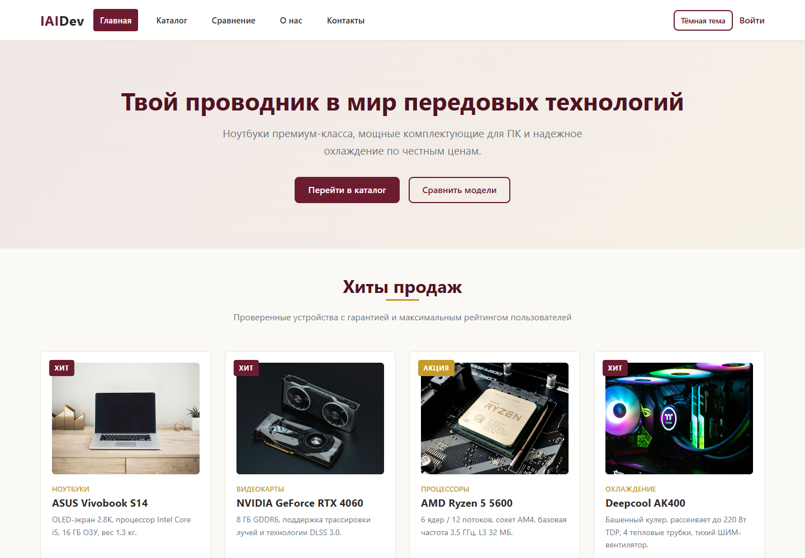
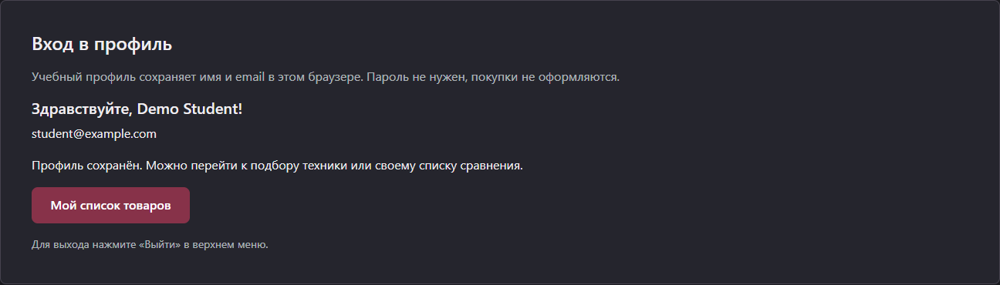
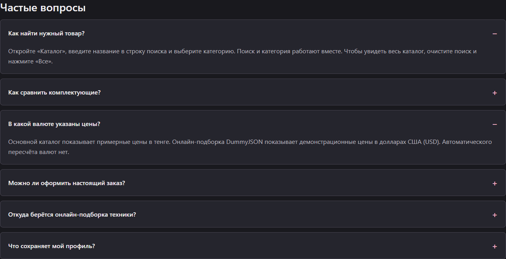
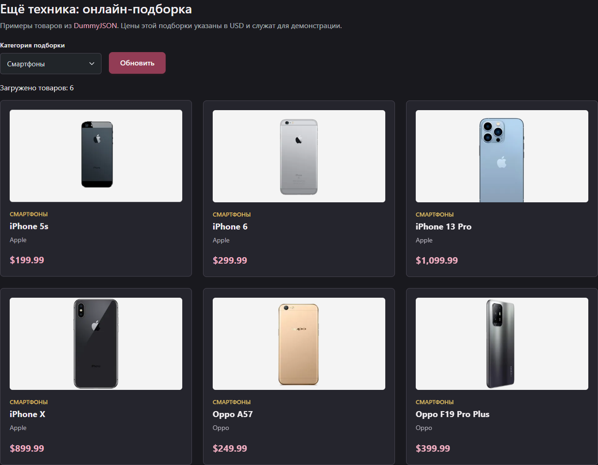
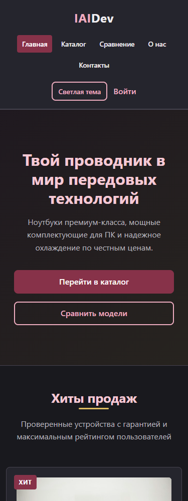

# IAIDev - Final Project Report

**Курс:** Front-End Web Development. **Команда:** Yermakov Ilya, Khametov Ilyas, Askar Azamat. **Дата подготовки:** 16.11.2026.

**Сайт:** https://taillin.github.io/online-store-front/

**Репозиторий:** https://github.com/Taillin/online-store-front

## 1. Цель и структура

IAIDev - учебный магазин компьютерной техники для Казахстана. Цель - дать пользователю возможность посмотреть устройства, найти товары, сравнить характеристики и попробовать интерактивные функции. Final продолжает Midterm и Endterm с той же темой и командой.

| Страница | Содержание |
| --- | --- |
| index.html | Главная, популярные товары, преимущества |
| catalog.html | Поиск, фильтры, основной каталог и онлайн-подборка |
| compare.html | Характеристики и личный список товаров с CRUD |
| about.html | Информация о проекте, галерея, FAQ, источники |
| contact.html | Вход, профиль, учебные формы регистрации и связи |

На всех страницах одинаковая навигация, цвета, шрифт, кнопки темы и профиля. Используются семантические HTML5-элементы, внешняя таблица стилей, Flexbox и Grid. Макет адаптируется к телефону, планшету и компьютеру.

## 2. JavaScript: тема и вход

Тема хранится в localStorage под ключом `iaidev-theme`. Файл `js/theme.js` читает значение перед отображением страницы и устанавливает `data-bs-theme` на элементе html. Кнопка в `js/final.js` переключает значение, меняет подпись и сохраняет выбор. Bootstrap и CSS-переменные применяют цвета ко всем страницам.

Форма входа проверяет имя длиной 2-40 символов и формат email. При успехе сохраняется объект `{name, email}` в `iaidev-user`. `JSON.stringify()` используется при записи, `JSON.parse()` при чтении. После обновления показываются профиль и кнопка выхода. `removeItem('iaidev-user')` удаляет только профиль; тема и товары остаются.

Это локальная демонстрация входа, а не серверная аутентификация. Пароли не сохраняются. Ошибки хранилища и неверный сохранённый JSON обрабатываются без падения сайта.

## 3. jQuery: FAQ

На странице «О нас» шесть вопросов о поиске, сравнении, валютах, заказах, API и профиле. Обработчик клика вызывает `.slideToggle(200)`. Ответ плавно открывается или закрывается; значок меняется между + и минусом. `aria-expanded` сообщает состояние, `aria-controls` связывает кнопку с ответом. `.stop(true, true)` предотвращает очередь анимаций. При системной настройке уменьшения движения анимация отключается.

Из Endterm сохранены поиск и фильтры, CRUD с localStorage, формы валидации и галерея с jQuery fade-эффектами и клавиатурной навигацией.

## 4. Публичный API

Используется открытый [DummyJSON Products API](https://dummyjson.com/docs/products). Он возвращает демонстрационные товары, относящиеся к теме магазина. Пример запроса: `https://dummyjson.com/products/category/laptops?limit=6`. Вторая категория - `smartphones`.

Функция `loadApiProducts()` выполняет `fetch()`, проверяет `response.ok`, читает JSON и заполняет карточки из HTML template. Название, бренд и цена вставляются через `textContent`. Пользователь может выбрать категорию или повторить запрос кнопкой «Обновить».

Показаны состояния загрузки, пустой выборки и ошибки. `try/catch/finally` обрабатывает сбой и возвращает кнопки в доступное состояние. AbortController ограничивает ожидание десятью секундами. При недоступном фото используется локальная иллюстрация. USD в онлайн-подборке явно отделены от примерных цен основного каталога в тенге.

## 5. Процесс, вклад участников и проверки

Сначала были сопоставлены критерии Final с существующим Endterm. Затем добавлены четыре требуемые функции без смены стека. Статические изображения, Bootstrap и jQuery перенесены в проект. Исправлены ссылки «В корзину», которые вели к сравнению или каталогу: теперь их подписи соответствуют действию. После этого выполнены браузерные проверки, подготовлены скриншоты и материалы защиты. GitHub Pages публикует содержимое корня ветки main.

| Участник | Вклад в основу по исходному README | Ответственность за подготовку Final |
| --- | --- | --- |
| Yermakov Ilya | Главная, каталог, поиск, фильтры, галерея | Разобрать и показать fetch, JSON, категории и ошибки API |
| Khametov Ilyas | Сравнение, контакты, о проекте, валидация регистрации | Разобрать и показать вход, валидацию, сохранение и выход |
| Askar Azamat | Стили, адаптивность, CRUD, localStorage | Разобрать и показать тему, FAQ и адаптивность |

Вторая колонка отражает сведения исходного Endterm README. Третья задаёт распределение подготовки к защите, а не утверждает самостоятельное авторство сгенерированных изменений.

Проверены: сохранение темы; вход/выход и переходы между страницами; валидация; FAQ; реальный ответ API, категории и обновление; искусственно вызванные HTTP 503, пустой и неверный JSON, восстановление запроса; старые CRUD, поиск и галерея. Все пять страниц проверены в двух темах при ширине 375, 768 и 1440 px. Не обнаружены горизонтальный выход макета за экран, отсутствующие локальные изображения или необработанные JavaScript-ошибки. Скриншоты получены в Chrome из работающей локальной версии. Проверка GitHub Pages фиксируется отдельно в CHECKLIST.md.

## 6. Источники и помощь ИИ

OpenAI ChatGPT / Codex использовался для доработки кода Final, исправлений, браузерных проверок, подготовки отчёта и пособия к защите. Указание помощи ИИ также присутствует на каждой странице сайта. Участникам необходимо самостоятельно изучить код и объяснить решения на защите.

Bootstrap 5.3.3 и jQuery 3.7.1 включены локально с лицензиями. Фотографии Unsplash иллюстративные и унаследованы из Endterm. Источники перечислены в ASSETS.md. Это учебный сайт: оплаты и реальной доставки нет, формы не отправляют сообщения, вход не проверяет личность. Интернет требуется для API; остальные ресурсы включены в папку.

Дедлайн по информации команды - 18.11.2026. Точное время указано в LMS. Каждый участник должен отдельно сдать ссылку на сайт и репозиторий до дедлайна. После него коммиты сдаваемой версии запрещены требованиями курса.
